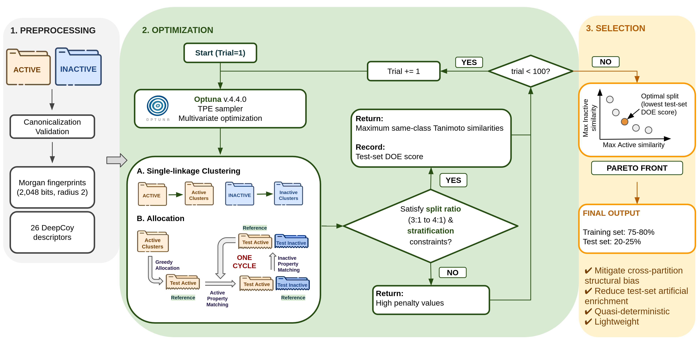

# Resplitting LIT-PCBA with MolSCISSOR: A Memory-Efficient, Quasi-Deterministic Framework for Reducing Structural and Physicochemical Biases

Reliable training-test partitioning is essential for developing and evaluating virtual screening (VS) methods, 
particularly in the era of machine learning (ML). However, existing molecular dataset splitting approaches do not 
simultaneously address key challenges in rigorous VS evaluation: cross-partition structural bias, test-set inter-class 
physicochemical bias, high memory requirements, limited scalability, stochastic allocation, the lack of automated 
optimization and flexible training-test similarity control. 

We introduce MolSCISSOR, a lightweight, memory-efficient, 
quasi-deterministic framework for stratified data partitioning that integrates clustering and training-test allocation 
through multi-objective optimization. MolSCISSOR is used to repartition [**LIT-PCBA**]( https://doi.org/10.1021/acs.jcim.0c00155), a well-established VS benchmark comprising 15 target-specific datasets of experimentally confirmed actives and inactives, exhibiting substantial class imbalance, many of which are large-scale. We show that simple baseline ML models achieve significantly above-chance screening 
performance on the original [**AVE**](https://doi.org/10.1021/acs.jcim.7b00403)-derived partitions, indicating structural bias. The MolSCISSOR-generated benchmark, SPLIT-PCBA, 
is more challenging than both the AVE variant and those obtained using a clustering-based workflow employing [**BitBIRCH-Lean**](https://doi.org/10.1039/d5dd00493d), with stricter cross-partition structural separation and improved physicochemical balance between test-set actives and inactives. MolSCISSOR mitigates stochastic variability, requires less memory than AVE, [**Lo-Hi**](https://arxiv.org/abs/2310.06399) and [**DataSAIL**](https://www.nature.com/articles/s41467-025-58606-8),
and supports multiple split configurations with varying cross-partition similarity.


## Table of Contents

- [Workflow](#Workflow)
- [Dataset](#Dataset)
- [Installation](#Installation)
- [Running MolSCISSOR](#Running)
- [Metric calculation](#Metric)
- [Benchmarking models](#model)
- [FAQ](#FAQ)
- [Contact](#Contact)


<a id="set-up"></a>


## Workflow
<a id="Workflow"></a>


## Dataset
<a id="Dataset"></a>
Inside `Data/` directory, you will find:
- `benchmark/`: This folder contains benchmarking results of target-specific ML models on three LIT-PCBA training-test variants (AVE-unbiased 
LIT-PCBA, bblean-LIT-PCBA, SPLIT-PCBA)
- `example/` : This folder contains example data to run MolSCISSOR
- `metric/`: This folder contains structural similarity-related metrics of three LIT-PCBA training-test variants (AVE-unbiased 
LIT-PCBA, bblean-LIT-PCBA, SPLIT-PCBA)

Compositions of three LIT-PCBA training-test variants (AVE-unbiased LIT-PCBA, bblean-LIT-PCBA, SPLIT-PCBA), and relevant data to demonstrate the data-order dependency in the bblean clustering algorithm can be found in: [**Zenodo**](https://zenodo.org/records/23942580)

## Installation 
<a id="Installation"></a>

Installation of MolSCISSOR environment
```
conda create -n molscissor python=3.11
conda activate molscissor

#install bblean
cd ~/
git clone https://github.com/mqcomplab/bblean.git
cd bblean
pip install -e .

#(Optional) install OpenBabel
conda install -c conda-forge openbabel -y

#install molscissor
cd ~/
git clone https://github.com/caominhtr/molscissor
cd molscissor
pip install "setuptools<70.0.0" wheel six cython
pip install --no-build-isolation -e . --find-links https://download.pytorch.org/whl/cu124
```


## Running MolSCISSOR
<a id="Running"></a>

### Step 1: Input preparation
Two separated files containing active and inactive compounds are required. Each row corresponds to a SMILES string. 

- The first column: SMILES string
- The second column: corresponding ID.
- The third column: corresponding cluster index, **required only when using an external clustering algorithm**; otherwise, this column can be omitted. Pre-clustering active and inactive datasets separately is recommended to optimize subsequent MolSCISSOR allocation.

The example of dataset in `.smi` format can be found at `Data/example/` including `active.smi` and `inactive.smi`, and examples of dataset with cluster index `active_cluster.smi` and `inactive_cluster.smi`.

### Step 2: Running MolSCISSOR

#### 2.1. Running MolSCISSOR with optimization option (default)

```
molscissor      -active Data/example/active.smi \
                -inactive Data/example/inactive.smi \
                -algo molscissor \
                -outdir result 
```
Other arguments can be modified by users:
-  `-upperActive`, `-upperInactive`: Similarity thresholds for actives and inactives are sampled from 0 to upper values. Can be modified separately for each class by user's choice. Default of 0.70 for both classes.
- `-k`: split ratio. Ratio of train/test from (k-1):1 to k:1. Default of 4.
- `-cycle`: number of cycles of iterative allocation. Default of 1.
- `-iter`: number of Optuna's optimization steps. Default of 100.


#### 2.2. Running MolSCISSOR with optimization option (continue running from last checkpoint)
This is applied when previous optimization processes were terminated prior to finishing `iter` steps.
```
molscissor      -active Data/example/active.smi \
                -inactive Data/example/inactive.smi \
                -algo molscissor \
                -continue_tune \
                -outdir result 
```

#### 2.3. Running MolSCISSOR with selected threshold (no optimization)

```
molscissor      -active Data/example/active.smi \
                -inactive Data/example/inactive.smi \
                -algo molscissor \
                -no_tune \
                -thresholdActive 0.4 \
                -thresholdInactive 0.8 \
                -outdir result
```
#### 2.4. Running bblean clustering-based split

```
molscissor      -active Data/example/active.smi \
                -inactive Data/example/inactive.smi \
                -algo bblean \
                -outdir result 
```

#### 2.5. Running only MolSCISSOR allocation on pre-defined cluster index from other clustering algorithms


```
molscissor      -active Data/example/active_cluster.smi \
                -inactive Data/example/inactive_cluster.smi \
                -algo other \
                -outdir result 
```


## Metric calculation
<a id="Metric"></a>

To calculate structural similarity-related metrics, please run:
```
python src/molscissor/calc_metrics.py   -aTrain path/to/train/active \
                                        -iTrain path/to/train/inactive \
                                        -aTest path/to/test/active \
                                        -iTest path/to/test/inactive \
                                        -metric AVE
                                        -o result/AVE.txt
```
`-metric` can be `AVE`, `maxTani`, or `scaledlpi`

## Benchmarking models
<a id="model"></a>

To launch target-specific ML-models, please run:
```
python src/molscissor/model.py          -aTrain path/to/train/active \
                                        -iTrain path/to/train/inactive \
                                        -aTest path/to/test/active \
                                        -iTest path/to/test/inactive \
                                        -id abc \
                                        -model RF \
                                        -feature morgan \
                                        -seed 42 \
                                        -o result
```
For `-model` options, it can be `RF`, `SVC`, `XGB`, `MLP`, `graphconv`, or `chemberta`

For `-feature` options, it can be `morgan`, `daylight`, `torsion`, or `rdkit`. Only applicable when `model` is `RF`, `SVC`, `XGB`, `MLP`. Omit this flag when `model` is `graphconv` or `chemberta`.

The result can be found at `result/Metrics.txt`:
```
id,ROC-AUC,NEF1%,BEDROC(alpha=160.9),seed
```

## FAQ
<a id="FAQ"></a>

**1. After 100 trials of optimization, what if no optimal split is obtained?**

Although this scenario is too extreme to happen, try to change the `k` (split training/test ratio), or increase the `iter` (number of optimization steps), or increase search space of threshold `upperActive` and `upperInactive`.

**2. Why does my final split not have the AVE bias as low as expected after optimization?**

Since MolSCISSOR is designed to retain all molecules (contrary to AVE and Lo-Hi), it cannot fully eliminate high underlying dataset bias; it can only find the best available split given the data.


## Contact
For further queries, please contact: 
- Cao-Minh Truong (cao-minh.truong@u-pariscite.fr)
- Dr. Viet-Khoa Tran-Nguyen (viet-khoa.tran-nguyen@u-paris.fr)
- Pr. Olivier Taboureau (olivier.taboureau@u-paris.fr)

---------------------------------------------------------------------------------------------------------------------------------------------------
This work was carried out at the Unité de Biologie Fonctionnelle et Adaptative (BFA), INSERM U1133, CNRS UMR8251, Université Paris Cité, France. The latest version of all data and source code provided herein was updated and made available free of charge in November 2026, and is subject to copyright.
